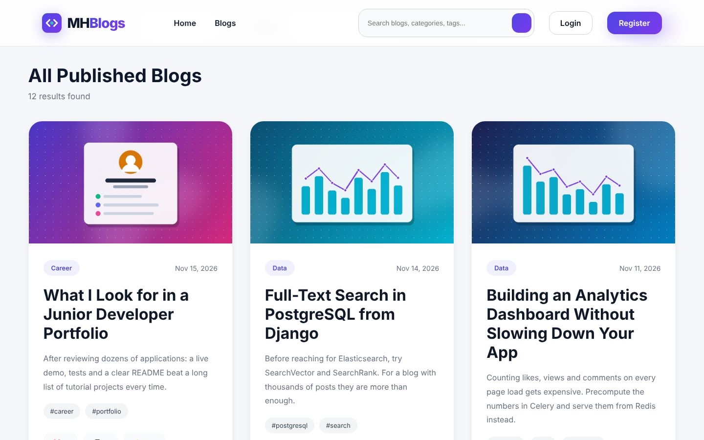
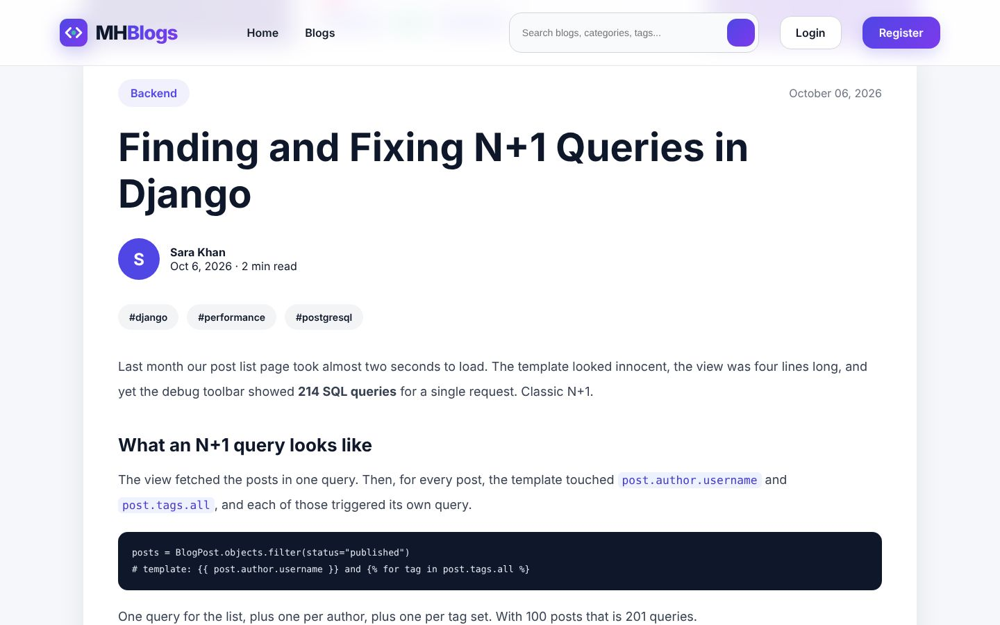
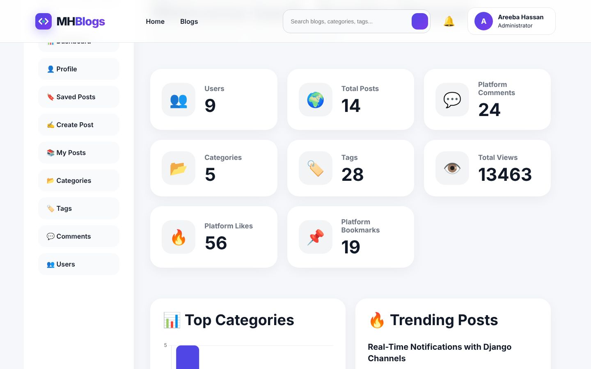
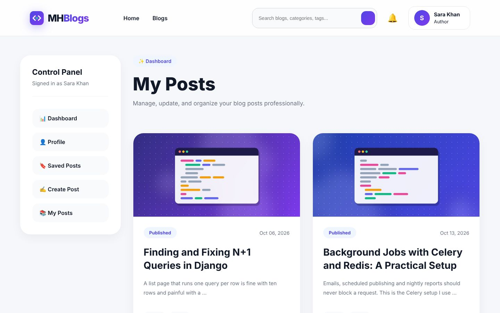
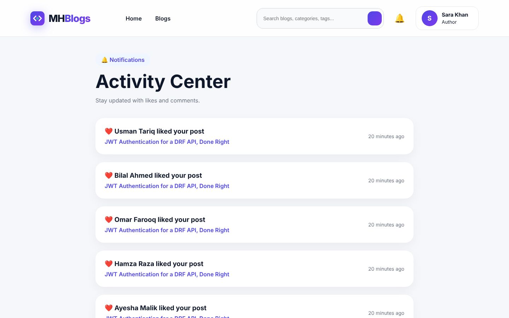
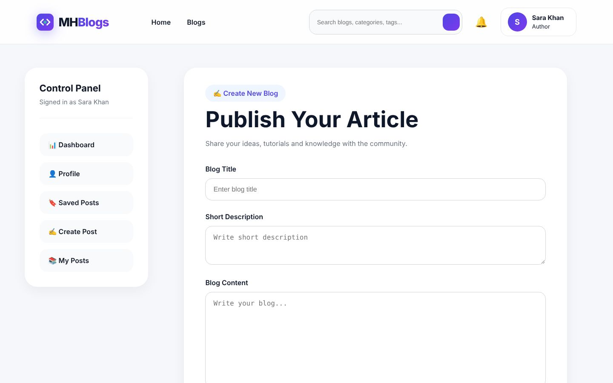

<p></p>

# MHBlogs: Advanced Blog System

[](https://github.com/MuhammadHaseeb3112/Advanced-Blog-System/actions/workflows/ci.yml)


[](https://mh-blog.duckdns.org/accounts/login/)

**MHBlogs** is a multi-author blogging platform built with Django. Authors write, schedule and publish posts; readers like, bookmark and comment; and authors see likes and comments arrive in real time over WebSockets. Background work (emails, scheduled publishing, trending scores) runs in Celery, and everything is also available as a JWT-secured REST API with OpenAPI docs.

**Live demo:** [mh-blog.duckdns.org](https://mh-blog.duckdns.org/accounts/login/). Sign in with one click as an **Author**, a **Reader** or a read-only **Admin** (analytics dashboard, users and moderation pages); the demo data resets every night.


## Highlights

- **Real-time updates.** Django Channels pushes like, bookmark and comment counts to everyone reading a post, and sends authors a live notification.
- **Background jobs.** Celery and Redis send verification and welcome emails, publish scheduled posts, rank trending posts, email weekly recommendations and clean up old notifications. Celery Beat runs the schedule.
- **Accounts.** Email sign-up with verification, login by email, password reset, Google and GitHub login (django-allauth), and three roles: admin, author and reader.
- **REST API.** Django REST Framework with JWT (rotating refresh tokens, blacklisted on logout), filtering, search, pagination, throttling and Swagger/ReDoc docs.
- **Privacy by default.** Drafts and scheduled posts are visible only to their author and to admins, on the website and in the API.
- **Analytics dashboard.** Admins see platform totals, a top-categories chart and trending posts, precomputed hourly by Celery and cached in Redis.
- **Tested.** 84 tests cover models, views, the API, permissions, Celery tasks and WebSockets, and run on PostgreSQL in GitHub Actions on every push.

## Screenshots

| Blog list | Post page |
|---|---|
|  |  |
| **Admin analytics dashboard** | **My posts** |
|  |  |
| **Live notifications** | **Write a post** |
|  |  |

## Deployment

Runs on Oracle Cloud with Docker Compose behind Caddy: Daphne for HTTP and WebSockets, a Celery worker and Celery Beat, PostgreSQL and Redis. Every push to `main` is tested in GitHub Actions and then deployed over SSH with a health check and automatic rollback. See [deploy/DEPLOY.md](deploy/DEPLOY.md).

## Tech stack

| Area | Tools |
|---|---|
| Backend | Python 3.13, Django 6, Django REST Framework, Django Channels (Daphne) |
| Data | PostgreSQL 16, Redis (cache, Celery broker, channel layer) |
| Background jobs | Celery, Celery Beat (database scheduler), Flower |
| Auth | django-allauth (email, Google, GitHub), Simple JWT, dj-rest-auth |
| API docs | drf-spectacular (Swagger UI, ReDoc) |
| DevOps | Docker Compose, Nginx, GitHub Actions |

## Project structure

```
accounts/   custom user model (email login, roles), sign-up and email verification
blog/       models, real-time consumers, Celery tasks, signals
  views/    website views split by area: posts, interactions, dashboard, authoring, moderation
  tests/    model, view, task and WebSocket tests
api/        REST API: serializers, viewsets, permissions, filters, pagination
core/       settings (base, development, production, test), ASGI/WSGI, Celery app
templates/  server-rendered pages
```

## Run it locally

With Docker:

```bash
cp .env.example .env          # then fill in the values
docker compose up --build       # runs migrations on start
docker compose exec web python manage.py seed_demo
```

Open http://localhost and sign in as `sara@demo.blog` / `DemoPass123!` (author). `seed_demo` creates three authors, a reader, nine published posts, a draft, a scheduled post, comments and likes.

Without Docker, start PostgreSQL and Redis yourself, then:

```bash
python -m venv venv && source venv/bin/activate
pip install -r requirements.txt
export REDIS_HOST=127.0.0.1    # "redis" by default, for Docker Compose
python manage.py migrate
python manage.py seed_demo
python manage.py runserver
celery -A core worker -l info  # in a second terminal
celery -A core beat -l info    # in a third terminal
```

Google and GitHub login buttons appear once you add the matching *Social application* in the Django admin.

## API

| Endpoint | Purpose |
|---|---|
| `POST /api/register/` | Create an account (sends a verification email) |
| `POST /api/token/` · `/api/token/refresh/` · `/api/logout/` | JWT login, refresh, logout |
| `/api/blogs/` | List, search, filter and create posts; `/api/blogs/<slug>/like/` and `/bookmark/` |
| `/api/blogs/trending/` · `/most_viewed/` · `/featured/` | Ranked post lists |
| `/api/comments/` · `/api/categories/` · `/api/tags/` · `/api/notifications/` | Related resources |
| `/api/dashboard/` · `/api/analytics/` | Author statistics |
| `/api/docs/` · `/api/redoc/` | Interactive documentation |

## Tests

```bash
DJANGO_SETTINGS_MODULE=core.settings.test python manage.py test
```

The test settings swap Redis for in-memory backends and run Celery tasks eagerly, so only PostgreSQL is needed.

## License

MIT. See [LICENSE](LICENSE).

---

Built by [Muhammad Haseeb](https://github.com/MuhammadHaseeb3112) · [Portfolio](https://muhammadhaseeb-portfolio-six.vercel.app/) · [LinkedIn](https://www.linkedin.com/in/codewithmuhammadhaseeb)
